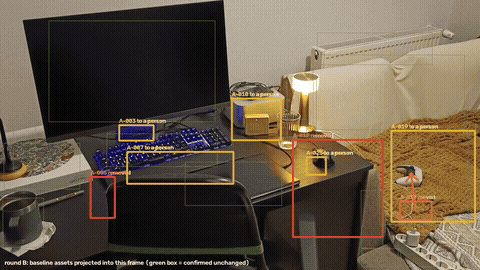
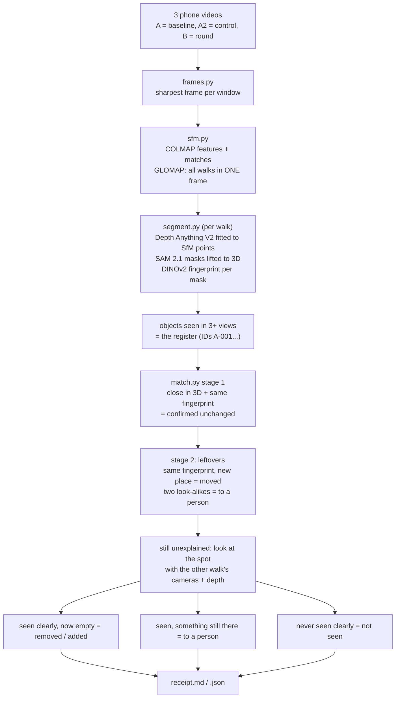
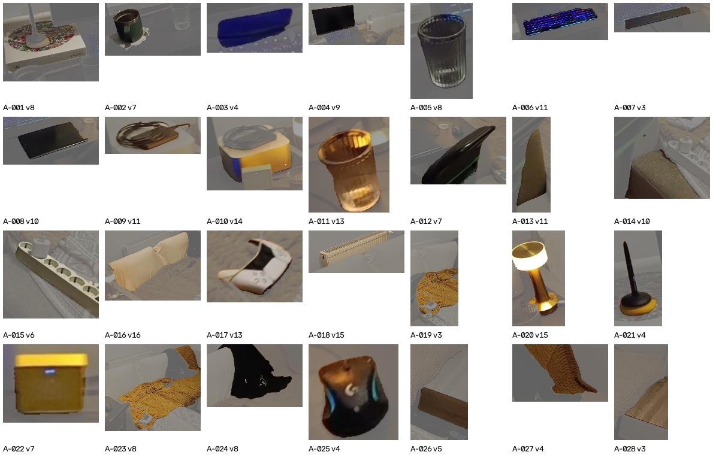

# Seen Again

**Did anything change since the last walk-through?** Film a room twice with a phone. Seen Again puts both walks in
one 3D frame, finds the objects, gives each one an ID, and writes a **receipt per asset**: *confirmed unchanged*,
*moved*, *removed*, *added*, *to a person*, or *not seen clearly*.

It is a small prototype inspired by Yodo Labs' write-up
[Asset identity across seasons](https://yodolabs.jp/en/case-studies/asset-identity-across-seasons) and
[YODO Asset World](https://yodolabs.jp/en/asset-world) ("the same asset is found again by position and shape").
It is an independent learning project, built in one evening, not affiliated with Yodo Labs, and it uses none of
their code or data. It is my first change-detection / re-identification project.



<sub>Round B. Every asset from the baseline walk is projected into the new frame with the new camera pose.
Green box = confirmed unchanged. Orange = moved (arrow to where it went). Red = its old spot is empty. Yellow = a person
should look. The PS controller moved ~10 cm; the system measured 13 cm.</sub>

## Why

Yodo's case study makes three points that I wanted to try on my own desk:

1. **Localise the camera, then project.** Appearance alone is not enough to say "this is the same thing"
   (identical objects, other lighting). If the new camera is placed in the old model, each old asset tells you
   exactly where to look.
2. **Two stages.** First confirm what did not move; only then try to explain what is left (relocated, new, gone,
   ambiguous), and send the unclear cases to a person.
3. **"Not seen" is not "unchanged".** A receipt must say *changed*, *confirmed unchanged* or *not seen clearly*.
   The same honesty idea is in their PLATEAU work (`covered = false` is never green).

## How it works



| Step | File | Notes |
|---|---|---|
| Frames | `seenagain/frames.py` | 15 fps sampled, sharpest of each 3 kept (walking blur) |
| One 3D frame for all walks | `seenagain/sfm.py` | pycolmap SIFT, pairs inside each walk + across walks; global mapper (GLOMAP) |
| Objects in 3D | `seenagain/segment.py` | per frame: monocular depth fitted to that frame's SfM points (`1/z = a·d + b`, ~1% median error); SAM 2.1 masks → 3D; masks fused across frames when their voxels overlap and DINOv2 fingerprints agree |
| Receipt | `seenagain/match.py` | two-stage Hungarian matching; 3D visibility / occupancy check for everything left over |
| Scoring | `seenagain/score.py`, `gt_desk.json` | ground truth written down by me after filming |
| Figures | `seenagain/viz.py`, `seenagain/sheet.py` | GIF above, top-down map, contact sheet of the register |
| Tests | `tests/test_match.py` | synthetic scene with known answers (moved, removed, added, hidden, identical twins) |

torch and pycolmap crash in one process on macOS (two OpenMP runtimes), so every step is its own process and they
talk through files. That turned out to be a nice way to inspect each step.



## Evaluation

Three 10-second 720p phone clips of my desk and couch, evening light.
**A** = baseline. **A2** = filmed again right away, nothing changed (control). **B** = after 5 changes:
chair rotated, two glasses moved ~10 cm, PS controller moved ~10 cm, eyeglasses on the couch moved ~10 cm.
Thresholds were **frozen after the control and before looking at B** (`params_frozen.json`).

| Round | Rules | Real changes | Caught as a change | Right type | False changes | To a person | Not seen | Confirmed unchanged |
|---|---|---|---|---|---|---|---|---|
| A2 (control) | v1 | 0 | 0 | 0 | **0** | 10 | 0 | 22 |
| B | v1 (frozen) | 5 | 3 | 1 | 2 | 14 | 3 | 17 |
| B | v2 (post-hoc) | 5 | 3 | 1 | **0** | 15 | 3 | 18 |
| A2 (control) | v2 | 0 | 0 | 0 | **0** | 10 | 0 | 22 |

| Object | Truth | System (v2) | Why |
|---|---|---|---|
| PS controller | moved ~10 cm | **moved 13 cm** | |
| chair | rotated | removed + a new object added | SAM caught only a 16 cm patch of the chair back; turned 90°, that patch moved 20 cm and looks different |
| glass by the mug | moved ~10 cm | removed (old spot correctly empty) | the moved glass was never re-detected: transparent, and half hidden by the turned chair |
| glass by the lamp | moved ~10 cm | missed (measured 2.5 cm) | depth sees *through* glass, so its 3D points lean toward the background |
| eyeglasses on the couch | moved ~10 cm | missed | too thin: never became an object in the register |

Joint reconstruction: the incremental mapper split the three walks into 15 pieces (64 of 150 frames placed);
the global mapper placed **150 / 150** (0.52 px reprojection error) in 1.5 minutes instead of 17.

### What round B taught us (v2, written after B)

- **False "moved" on big objects.** The radiator "moved 7 cm": a big object's centre shifts with the part you
  see. → The static radius now grows with object size.
- **10 cm is the noise floor here.** The mouse (not touched) "moved 9.5 cm", and the controller (moved ~10 cm)
  measured 13 cm. With 10-second, 720p, dim clips, moves near the noise go to a person instead of being reported.
- **In-place changes.** A "removed" asset and a new object in the same 3D spot become one row, *changed in place
  (turned / reshaped)*. It did **not** fire for the chair: the masks covered only a patch of it, which moved
  further than its own size. The fix belongs in segmentation (whole objects, e.g. SAM 2 video propagation),
  not in a looser threshold.

v2 keeps the control at 0 false changes and removes both false alarms on B, but it was written after seeing B,
so it still needs a fresh round to count. The 3D occupancy check is what keeps the control clean: without it,
the 10 flaky detections on A2 would have been reported as 10 removals.

## Where this could go

- **Localise against the existing model** instead of re-running SfM on all walks, as a production system would:
  register only the new walk's frames (or a single robot frame) and project the register into them.
- **Whole-object masks and classes:** SAM 2 video propagation so a chair is one object; a VLM to name the class
  ("the photograph is the authority for class").
- **Glass and thin things:** flag transparent objects as low-confidence for depth; phone LiDAR / ARKit depth and
  metric scale instead of one tape measurement.
- **Gaussian splats** of each walk (see my [SplatIm](https://github.com/mert5961/SplatIm)) to show a reviewer the
  before/after from the same virtual camera.

## Run it

Python 3.12, macOS (Apple GPU via MPS) or Linux.

```bash
uv venv --python 3.12 .venv && uv pip install --python .venv/bin/python -r requirements.txt
mkdir -p checkpoints && curl -L -o checkpoints/sam2.1_hiera_base_plus.pt \
  https://dl.fbaipublicfiles.com/segment_anything_2/092824/sam2.1_hiera_base_plus.pt
# put three videos in data/: A.mp4 (baseline), A2.mp4 (control), B.mp4 (round)
./run_desk.sh
PYTHONPATH=. .venv/bin/python -m pytest -q tests
```

Stack: Python, pycolmap / GLOMAP, SAM 2.1, Depth Anything V2 Small, DINOv2, numpy, scipy, OpenCV, matplotlib.
The videos are not in the repo; the figures in `docs/` come from them.

---

Built by **Mert Barut**: compositor and technical artist, now building with GLSL, Gaussian splats and AI.
Portfolio: [mertbarut.me](https://mertbarut.me)
